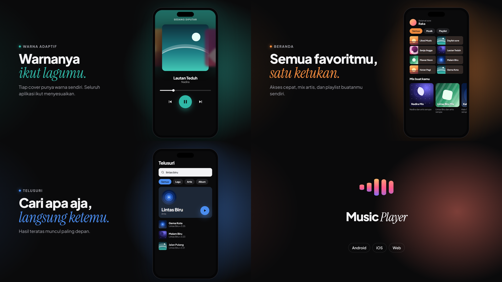
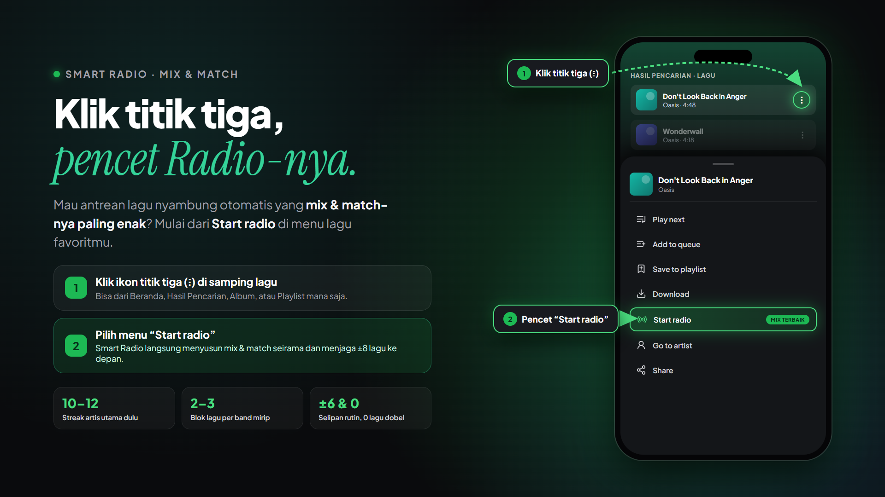
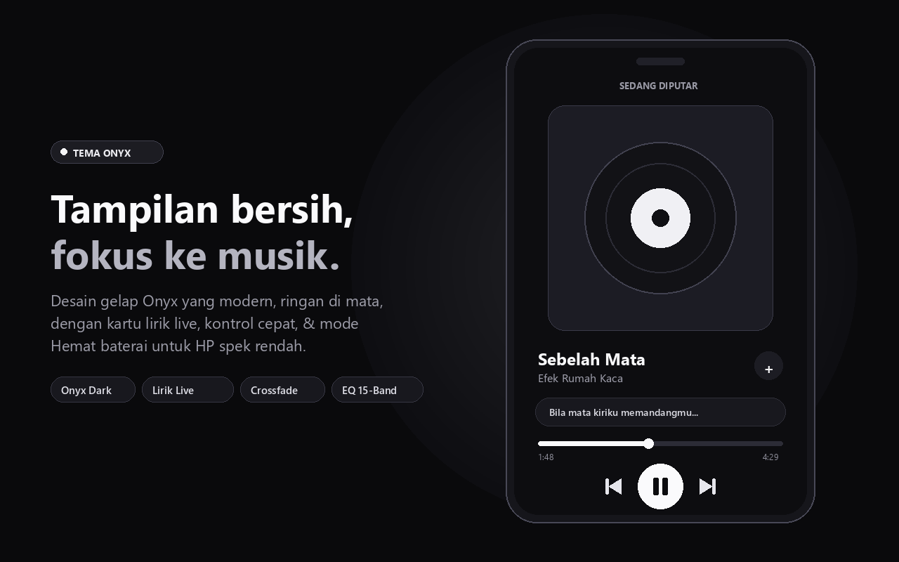
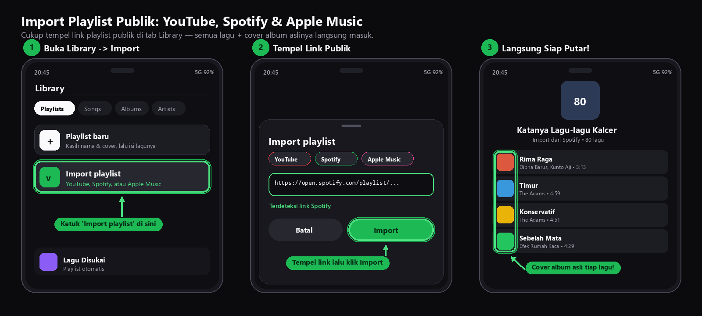
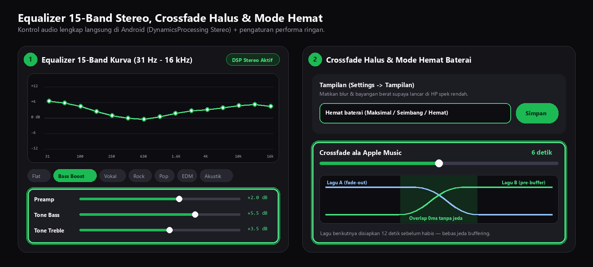
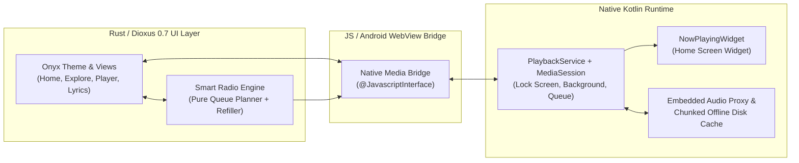

  
  <h1>Music Player</h1>
  
<strong>A lightweight Android music player with a clean single-tone Onyx theme, built with Rust, Dioxus 0.7, and native Kotlin audio services.</strong>

  

    
    
    
    
    
  

  

    
    &nbsp;
    
  

  
    Bookmark the direct link — it always downloads the newest release: 
    <code>https://github.com/h3rwthme/Music-/releases/latest/download/music-player.apk</code>
  

 

  

### Smart Radio Mix & Match — Cara Pakai Terbaik
> **Tips:** Klik ikon **titik tiga (`⋮`)** di samping lagu favoritmu lalu pilih **`Start radio`** supaya mesin **Smart Radio** langsung meracik mix & match yang paling pas (10–12 streak artis utama → blok 2–3 lagu per band mirip → selipan artis utama tiap ±6 lagu → 0 lagu dobel).

  

---

## Overview

**Music Player** is a personal cross-platform audio player engineered for speed, low footprint (`~8.3 MB` release APK), and editorial-grade visual polish. Its core UI and state engine are written in **Rust (Dioxus 0.7)** and bridged cleanly to a **native Android Kotlin foreground playback service**, giving uninterrupted background audio, lock-screen media controls, a home-screen widget, and smooth offline caching even on unstable mobile connections.

> **Repository Scope:** This repository serves as the public **portfolio showcase and binary release distribution hub** (`README`, visual showcase, changelog, and signed APK releases). Application source code is maintained privately.

---

## Visual Showcase

| Onyx Player | Import Playlists | 15-Band Equalizer & Crossfade |
| :---: | :---: | :---: |
|  |  |  |
| One neutral black & white palette with a blurred cover backdrop, live lyrics pill and quick controls. | Paste a public YouTube, Spotify or Apple Music playlist link to import it with original covers. | Drag the 15-band curve, adjust Preamp / Bass / Treble, and enjoy gapless equal-power crossfades. |

---

## Key Features

- **Single-Tone Onyx Theme** — One consistent neutral black & white palette across the app and widget, with a lightweight blurred cover backdrop on the player.
- **Smart Radio Universal & Poweramp-Style 15-Band Native Equalizer** — Deterministic, unit-tested queue planner (`smart_queue`) with skip-aware learning and Spotify-style playlist recommendations + Refresh — paired with a **15-band (`31 Hz–16 kHz`) native Android `DynamicsProcessing` Equalizer**, Preamp, Tone Bass/Treble, and anti-clipping Limiter.
- **Display Modes (`Maksimal / Seimbang / Hemat baterai`), Orbit 3D, Recap & Auto-Updater** — Dedicated `Hemat baterai` zero-blur performance mode for older Android devices, 3D Orbit cover ring, true random Shuffle from track #1, newest-first Artist discography, and in-app auto-download updates.
- **Resilient Offline Disk Cache** — Chunked HTTP Range (`206 Partial Content`) disk cache keeps scrubbing responsive on flaky networks and allows pinned tracks to play completely offline without mid-track stalls.
- **Native Background, Back Navigation & Lock-Screen Playback** — Dedicated Android `PlaybackService` with `MediaSessionCompat`, native audio queue mirroring, auto-advance while screen is off or gaming, audio focus handling, headphone-disconnect pause, and full Android Back gesture/button routing (`Sheet → History → Preserved Search → Home → Background Minimize`).
- **Custom Playlists with Cover Photos** — Create, edit, and organize personal playlists with custom uploaded cover artwork, persisted locally across updates.
- **Immersive Phone & Tablet Layout** — Edge-to-edge immersive system bars (`WindowInsetsControllerCompat`) and responsive multi-column grids tailored for both phones and tablets (e.g., 8.8"–11" displays).
- **Ultra-Light Footprint** — Optimized with `llvm-strip`, R8 code minification, and Android resource shrinking for a standalone `~8.3 MB` `arm64-v8a` APK.

---

## Architecture Highlights

---

## Tech Stack

| Layer | Technology |
| :--- | :--- |
| **Core UI & State** | Rust (Edition 2024), Dioxus `0.7`, Modular CSS Design Tokens |
| **Queue & Lyrics Engines** | Pure Rust modules with full unit test coverage (Smart Radio, LRC/ELRC/TTML parser, RGB contrast clamping) |
| **Native Android Layer** | Kotlin, `android.media.MediaPlayer`, `androidx.media` (`MediaSessionCompat`), `AppWidgetProvider`, `WindowInsetsControllerCompat` |
| **Build & Optimization** | `dx bundle`, Android NDK `llvm-strip`, Gradle R8 minification + resource shrinking, `zipalign`, `apksigner` |

---

## Installation & Easy Updates

### Requirements
- **Android 7.0 (API 24) or higher**
- **64-bit ARM (`arm64-v8a`)** — supported by virtually all modern Android phones and tablets

### Install / Update Steps
1. Open the direct download link on your Android device:
   - **[Download Latest `music-player.apk`](https://github.com/h3rwthme/Music-/releases/latest/download/music-player.apk)**
2. Tap the downloaded APK file (allow *"Install unknown apps"* if prompted on first install).
3. Tap **Install / Update**.
   - Updating over an existing installation preserves all your saved playlists, cover photos, listening history, and offline cache automatically.

---

## Release History

See [CHANGELOG.md](CHANGELOG.md) or browse [GitHub Releases](https://github.com/h3rwthme/Music-/releases) for version notes and previous builds.

---

  Built with Rust & Kotlin by <a href="https://github.com/h3rwthme">@h3rwthme</a>

